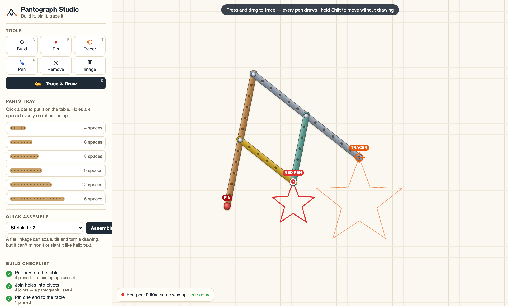

# Pantograph Studio

**Build it, pin it, trace it.** Pantograph Studio is a browser-based linkage simulator. You assemble a pantograph from rigid bars with evenly spaced holes, trace an image with it, and watch the pens draw scaled, rotated or upside-down copies.

**Live:** https://gitkarthik.github.io/pantograph/

[](https://gitkarthik.github.io/pantograph/)

## Features

- **Build your own linkage:** take bars from the parts tray (4 to 16 hole-spaces long) and join them by dropping one hole onto another. Holes are evenly spaced, so ratios line up.
- **Quick assemble:** start from a ready-made pantograph:
  - **Same way up:** shrink 1:4, 1:3, 1:2 or 2:3, or enlarge 3:2, 2:1 or 3:1
  - **Upside-down (turned 180°):** same size, 1:2 or 2:1
  - **Tilted, same size:** ±15°, ±30° or ±90°, using Sylvester's skew pantograph
- **Trace an image:** upload or drag-and-drop an image onto the table, then move, resize and fade it.
- **Multiple pens:** use up to 5 pens, each in its own colour. Every pen draws at once while you trace.
- **Live feedback:** a build checklist with the linkage's mobility count, and a display that shows the scale and angle of each pen's copy, so you can spot when a copy is being distorted.
- **Export:** save your drawing as a PNG.

## How to use

1. Click **Assemble a 1 : 2 pantograph**, or build one yourself from the **Parts tray**.
2. With **Pin**, pin a hole to the table.
3. With **Tracer**, choose the hole you will trace with.
4. With **Pen**, choose one or more holes to draw with.
5. Optionally, add an image to trace.
6. Switch to **Trace & Draw** and drag. Every pen draws a copy of what the tracer follows.

### Tools and shortcuts

| Key | Tool | What it does |
|---|---|---|
| `V` | Build | Drag bars and pins, join holes, scroll over a bar to rotate it |
| `P` | Pin | Click a hole to pin it to the table, or click again to unpin it |
| `T` | Tracer | Make a hole the tracing stylus |
| `N` | Pen | Add a pen to a hole, or click an existing pen to lift it off |
| `X` | Remove | Remove a pin, tracer or pen, separate a joint, or delete a bar |
| `I` | Image | Move the image, or drag its corner to resize it |
| `D` | Trace & Draw | Drag to trace; hold `Shift` to move without drawing |
| `⌘/Ctrl + Z` | | Undo the last stroke |

## How it works

A flat linkage needs a **mobility of 2** so the tracer can follow any point. The app checks this with the planar Grübler count: 3 per bar, minus 2 per pivot, minus 2 per pin.

- **Classic 4-bar pantograph:** pinned at one end, the pen draws *k* × the traced shape, the same way up. Pinned at the middle joint instead, it draws −(1−k)/k ×, which is an upside-down copy.
- **Skew pantograph (plagiograph):** a hinged rhombus with rigid arms welded on. It draws a same-size copy turned by a fixed angle.

A flat linkage can scale, tilt and turn a drawing, but it **can't mirror it or slant it** like italic text.

The simulation uses position-based constraint projection. Every frame, the solver enforces pins, pivots and fixed bar lengths. When you drag, the linkage is moved in small steps so it follows smoothly and the pens leave clean lines.

## Running locally

There is no build step or dependencies. It is plain HTML, CSS and JavaScript:

```sh
python3 -m http.server 5178
```

Then open http://localhost:5178.

## Project structure

```
index.html   Page layout and sidebar controls
styles.css   Styling
app.js       Simulation, solver, rendering and UI
```

## Deployment

The site is served by GitHub Pages from the root of the `main` branch. Pushing to `main` redeploys it automatically.

## License

[MIT](LICENSE) © 2026 Karthik Kandasamy
